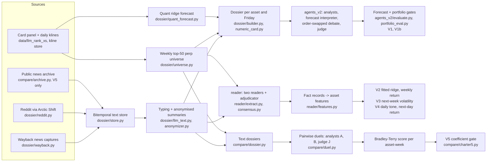

# Second multi-agent framework (`llm-multiagent-v2`)

Engineering guide to the second multi-agent framework: what the code does, how a registered run was produced, and
how to check and reproduce every verdict offline. Research results and their reasoning are recorded in
[`research/multiagent-v2/STATE.md`](../../research/multiagent-v2/STATE.md) and in the thesis chapter "Second
Multi-Agent Framework"; the devbox handoff is
[`research/multiagent-v2/HANDOFF_2026-11-17.md`](../../research/multiagent-v2/HANDOFF_2026-11-17.md).

**Status.** The family is closed: six registered attempts (V1, V1b, V2–V5), all without a passing verdict. No run is
active and no sealed window (Sealed-A 2025-01 to 2026-04, Sealed-B 2026-05 to 2026-12-11) has been read.

## Quick commands

All commands are offline. None calls a model, writes into `research_runs/` or reads a sealed window.

```bash
.venv/bin/python scripts/mav2.py status       # one row per run: receipt, verdict, headline gate, test sample, cost
.venv/bin/python scripts/mav2.py verify       # receipts + "no pinned file changed"; exit 1 on a problem
.venv/bin/python scripts/mav2.py replay V3    # recompute one run from its registered inputs, compare with stored outputs
.venv/bin/python scripts/mav2.py replay all   # every completed run (V1b, V2–V5)
.venv/bin/python scripts/mav2.py pinned       # files pinned by any receipt: never edit them
.venv/bin/python -m pytest -q tests/research/test_mav2.py           # fast checks, including the pin guard
.venv/bin/python -m pytest -q -m slow tests/research/test_mav2.py   # full replay of every run (needs data/)
```

`status` output on 2026-11-18:

| Run | Receipt | Verdict | Headline gate (needed ≥ 2.0) | Test sample | Recorded cost |
| --- | --- | --- | --- | --- | --- |
| C0 | complete | (probe) | — | — | $0.22 |
| V1 | failed | interrupted | not reached | — | $129.07 |
| V1b | complete | FAIL | encompassing t −0.02 | 66 weeks | $10.55 |
| V2 | complete | FAIL | text encompassing t 1.39 | 104 weeks | $5.75 |
| V3 | complete | FAIL | reader partial IC t −0.72 | 104 weeks | $0 |
| V4 | complete | FAIL | reader partial t −2.49 | 722 days | $0 |
| V5 | complete | FAIL | coefficient t −0.08 | 104 weeks | $4.74 in caches ($7.61 by balance) |

C0 is the extraction-quality probe of family `llm-news-event-extraction`; it chose the reader model and is not an
attempt of this family. V3 and V4 reuse the reader records paid for by V2. For V5 the call caches record $4.74; the
document-typing cache stores no cost, and the account balance fell by $7.61 over the run.

## Architecture

Three agent configurations were tried on one shared text pipeline. Every configuration sees anonymised text only
(assets become `Asset_A`, `Asset_B`, …; dates become relative; price levels are masked), fetches nothing itself and
answers in a strict JSON schema. Code, not an agent, turns answers into numbers and computes every gate.



### Configuration 1: debating agents (V1, V1b) — `tradingagents/agents_v2/`

One dossier per asset and decision Friday (`tradingagents/dossier/`) holds the anonymised news and Reddit summaries,
a numeric card, scheduled events and a quant ridge forecast with its trailing calibration record. Per dossier:
analysts read it, a forecast interpreter weighs the quant forecast, a judge without debate gives a probability of
beating the cross-section, and a seeded random subset of assets also gets an order-swapped bull/bear debate with its
own judge (`runner.py`, `graph.py`, prompts in `roles.py`, schemas in `schemas.py`). Model: `deepseek/deepseek-v4-pro`.
The evaluation (`evaluate.py`, `portfolio_eval.py`, Charter 1b tail in `charter1b.py`) asks whether the judge's
probability adds to the quant forecast (encompassing regression, Newey-West t) and runs a rule-twin portfolio.

### Configuration 2: readers plus a fitted model (V2, V3, V4) — `tradingagents/reader/`

Agents only read. Every news or community item about a universe member (`items.py`, `reading.py`) goes to two readers
that return typed fact records (`schema.py`: asset, relevance, event class, status, direction, materiality,
evidence); code checks the evidence quote against the text and an adjudicator settles only disagreements
(`extract.py`, `consensus.py`). Code aggregates records into asset features (`features.py`) and the evaluation
modules forecast with fitted models: `charter2.py` (weekly relative return beyond the quant forecast),
`charter3.py` (next-week volatility beyond price history and attention counts), `charter4.py` (daily decision at
00:00 UTC, next-day return). Model: `deepseek/deepseek-v4.1-flash`, temperature 0, reasoning off.

### Configuration 3: pairwise comparison (V5) — `tradingagents/compare/`

The reader records of the present material and of the public news archive (`archive.py`, ingested by
`scripts/cmp_archive_ingest.py`) form a seven-day text dossier per asset and week (`dossier.py`). For each pair of
dossiers, analyst A sees them in a drawn order and reviewer B in the opposite order; where the two name different
assets, adjudicator J decides. Code applies the consensus and fits one Bradley-Terry score per asset-week (`duel.py`).
An identification probe records whether the model can name the hidden asset or month (`scripts/cmp_probe.py`).
`charter5.py` tests whether the score adds to the quant forecast, price controls and news counts.

### Shared pieces

| Module | Role |
| --- | --- |
| `dossier/or_client.py` | Pinned OpenRouter structured-output client: model, providers and quantisation fixed per pin (`pro`, `flash`, `chrono`), spend cap per process |
| `reader/extract.py` `CallCache` | Content-addressed JSONL cache of every model answer; runs rebuild every agent table from it without calls |
| `agents_v2/charter1b.py` `verify_store` | Checks that the kline and funding stores match their registered digests |
| `tradingagents/research/` | Run lifecycle: registration, `ResearchRun` claim, hashed inputs and outputs, receipt verification |

## How a registered run was made

Every attempt followed the same steps; the files of each step are listed below.

1. **Charter.** A frozen markdown text under `docs/superpowers/specs/` states the question, data, gates and stop
   rules before any outcome is read. Its sha256 is pinned in the registration.
2. **Null gate and rehearsal.** The gates run on synthetic outcomes (`*_null_gate.py`, `llm_v2c1b_dryrun.py`) to
   measure false-pass rate and power, and the runner rehearses its whole tail on synthetic returns.
3. **Registration.** `*_register.py` writes `research/llm-v2-charter*/gates.json`: family, attempt budget,
   exposed windows, every input path with its sha256, and every source file of the run.
4. **Run.** `*_run.py` checks every input, claims the run with `ResearchRun.start`, rebuilds all agent tables from
   the call caches, joins the forward returns once, computes the gates in code and writes
   `research_runs/<run>/outputs/*.json` plus `complete.json`.

| Run | Charter | Registration builder | Runner | Evaluation module |
| --- | --- | --- | --- | --- |
| V1 | `2026-11-09-llm-v2-charter1-dev-run-charter.md` | `llm_v2c1_register.py` | `llm_v2c1_run.py` | `agents_v2/evaluate.py` |
| V1b | `2026-11-11-llm-v2-charter1b-dev-run-charter.md` | `llm_v2c1b_register.py` | `llm_v2c1b_run.py` | `agents_v2/charter1b.py` |
| V2 | `2026-11-12-llm-v2-charter2-reader-charter.md` | `reader_charter2_register.py` | `reader_charter2_run.py` | `reader/charter2.py` |
| V3 | `2026-11-13-llm-v2-charter3-volatility-charter.md` | `reader_charter3_register.py` | `reader_charter3_run.py` | `reader/charter3.py` |
| V4 | `2026-11-14-llm-v2-charter4-fresh-news-charter.md` | `reader_charter4_register.py` | `reader_charter4_run.py` | `reader/charter4.py` |
| V5 | `2026-11-15-llm-v2-charter5-direct-comparison-charter.md` | `cmp_charter5_register.py` | `cmp_charter5_run.py` | `compare/charter5.py` |

### Scripts by stage

| Stage | Scripts |
| --- | --- |
| Text collection | `dossier_news_discover.py`, `dossier_news_fetch.py`, `dossier_captures_dedupe.py`, `dossier_reddit_fetch.py`, `cmp_archive_ingest.py` |
| Side data | `dossier_categories_fetch.py`, `dossier_funding_fetch.py` |
| Dossiers and audits | `dossier_build.py`, `dossier_audit.py`, `dossier_reid_probe.py` |
| Agent system (V1, V1b) | `agents_run.py`, `agents_pilot_report.py`, `agents_preview_report.py`, `llm_v2c1_manifest.py`, `llm_v2c1b_manifest.py`, `llm_v2c1b_dryrun.py` |
| Reader (V2–V4) | `reader_items_build.py`, `reader_extract.py`, `reader_coverage_preview.py`, `reader_charter{2,3,4}_null_gate.py` |
| Comparison (V5) | `cmp_type.py`, `cmp_items_build.py`, `cmp_read.py`, `cmp_dossiers.py`, `cmp_duels.py`, `cmp_probe.py`, `cmp_null_gate.py`, `cmp_common.py` |
| Probe C0 | `llm_v2c0_*.py` |
| Registration and runs | `*_register.py`, `*_run.py` (table above) |
| Consolidation (read-only) | `mav2.py` |

Several scripts call a paid model or fetch from the network when run without their offline flags. A script name is
not a permit to run it; the closed family has no attempt left.

## Data

All data is git-ignored and is synced separately (laptop and Storage Box `laptop-archive/2026-11-17/`).

| Folder | Size | Contents |
| --- | --- | --- |
| `data/dossier/` | 667 MB | text store (`captures`, `reddit`), typing cache, built dossiers, quant forecasts, funding, re-identification flags |
| `data/reader/` | 117 MB | reading list (`items`, `docs`), reader call cache `calls.jsonl`, records, extraction manifest |
| `data/compare/` | 151 MB | archive text store and tables, typing, reader, duel and probe call caches, dossiers, duels, scores |
| `data/agents_v2/` | 62 MB | per-asset cached agent answers per week (`runs/charter1-preview`), Charter 1/1b manifests and store digests |
| `data/llm_rank_xs/` | 4 MB | card panel (`cards.parquet`) |

The public news archive is licensed CC-BY-NC-4.0: non-commercial thesis use with attribution, kept out of version
control.

## Reproducing a verdict

`scripts/mav2.py replay` (module `tradingagents/mav2/replay.py`) calls each runner's own `prepare` and the
evaluation module's `finalize` unchanged and repeats only the short glue between them. Compared with the run itself:

- no `ResearchRun` claim is made and nothing is written into `research_runs/`;
- every input is read through the sha256 pinned in the claim; a changed byte stops the replay;
- every agent answer comes from the registered call caches; nothing calls a model;
- the outcome join reads only the development window the run already used.

A replay therefore shows that the stored outputs follow from the registered inputs and the pinned code. It does not
re-test the hypothesis and cannot change a verdict. For V1b the cost tally (`cost.json`) is process state and is not
compared; the five other outputs are.

### Replay results (2026-11-18, laptop)

| Run | Outputs compared | Result | Time |
| --- | --- | --- | --- |
| V1b | forecasts, evaluation, portfolio, books, verdict | identical | — |
| V2 | forecasts, evaluation, portfolio, books, reader, verdict | identical | 108 s |
| V3 | forecasts, evaluation, reader, verdict | identical | 104 s |
| V4 | forecasts, evaluation, reader, verdict | identical except one descriptive panel (known cause below) | 155 s |
| V5 | scores, evaluation, comparison, verdict | identical | 242 s |

"Identical" means equal values, with floats equal to a relative 1e-9. Every verdict and every gate statistic
reproduces.

Two runs needed a replay-specific step, both traced to their cause:

- **V1b, the agent cache after the run.** The runner's cache check (`charter1b.verify_cache`) describes the cache
  before the run and cannot pass afterwards. The run completed the week V1 was interrupted in (2023-10-27,
  rewriting 50 pinned partial files) and wrote four older weeks. The spend cap then stopped it inside
  2023-09-22, leaving 32 per-asset files and no book for that excluded week. The replay checks the state the run
  left (`replay.post_run_cache`): all 3,111 frozen-week files against the registration, the five written weeks
  against the digests the run recorded in `cost.json`, and partial files only in the truncated week.
- **V4, the linear partial score panel `s_reader_lin`.** On 15 test days `tone_1d` is zero for every asset, and on
  2024-10-18 to 2024-10-20 both tone features are. The within-day OLS residual of a feature that is constant
  within the day is zero in exact arithmetic and rounding noise in floating point. Whether that noise is constant
  depends on the BLAS kernel of the CPU, and the exact variation test (`np.ptp(x) > 0`) then admits or drops the
  day. The univariate `tone_1d` panel has 722 days from the run machine and 707 on the laptop. On the three days
  without any tone the whole linear score is noise of order 1e-21, whose daily correlation is arbitrary
  (−0.0101 against −0.0103 mean). The panel is descriptive and listed in `replay.KNOWN_DIFFERENCES`; any other
  difference fails the replay.

**Observation on the V4 gate (post hoc, verdict unchanged).** The gate score `s_reader` also counts the three days
without any tone (daily correlations −0.04, +0.08, +0.33). With no tone to read, those values come from the
boosted-tree step on the price and attention controls, not from text. Without the three days the gate statistic
is −0.0151 with t −2.59 over 719 days, against −0.0145 with t −2.49 over 722 days as registered. Both years stay
negative, and the registered verdict stands as computed.

## Changing the code

The receipts pin 93 files by sha256 (`scripts/mav2.py pinned`): the four packages above, the runners and their
helpers, the charters, the registrations and `uv.lock`. An edit to any of them breaks the link between a verdict and the code
that produced it, and `tests/research/test_mav2.py::test_no_pinned_file_changed` fails.

- `uv.lock` is pinned as well: a dependency change shows up as a changed file. Keep the lockfile as it is unless a
  new run is registered with the new one.
- Put new code in new files (a new module, or a new package such as `tradingagents/mav2/`) that import the pinned
  ones.
- The interrupted V1 run is the one documented exception: its evaluation code was corrected for Charter 1b, which is
  why V1b exists. The exception is listed in `tradingagents/mav2/pins.py` (`EXPECTED_DRIFT`); any other change fails.
- New research needs its own charter, registration and family; this family has no attempt left.
- The OpenRouter key lives in `~/.secrets/openrouter.env` on each machine and never in the repository.
